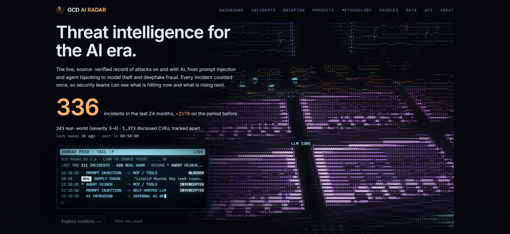
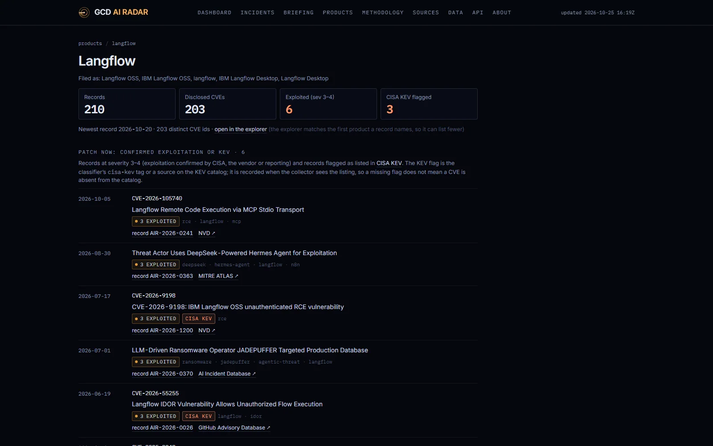

# GCD AI RADAR

**A public observatory of AI cybersecurity incidents: collected from open sources, deduplicated, classified and charted over time.**

Live at [gcd-ai-radar.vercel.app](https://gcd-ai-radar.vercel.app).

<a href="https://gcd-ai-radar.vercel.app"></a>

## Why I built this

I work in security and could not find one honest, source-linked count of how often AI systems are being attacked, or used to attack others. Vendor reports count articles and mix vulnerabilities with incidents, so I built a dataset that counts each event once and lets anyone check the source.

## What it tracks

Two kinds of incident, each deduplicated and linked to original reporting:

- **attack_on_ai**: an AI model, agent or AI-powered product was the thing exploited, abused or leaked.
- **ai_enabled_attack**: attackers used AI as a meaningful part of a cyberattack against someone else.

Counts are per incident, not per article: one event covered by fifteen outlets is one incident with fifteen sources. Disclosed CVEs are tracked apart and never counted as incidents.

Product watch pages gather everything that names one AI product or framework, newest first, with confirmed exploitation and CISA KEV flags up top:

<a href="https://gcd-ai-radar.vercel.app/products"></a>

Part of the gcd family ([gcdatlas.com](https://gcdatlas.com)).

## How it works

```
feeds + APIs ──▶ collector (GitHub Actions, every 6 h) ──▶ /data/*.json ──▶ Next.js static site (Vercel)
                 fetch → pre-filter → dedupe → LLM classify → publish/review/reject → commit
```

- All data lives as JSON in [`/data`](data), sharded by year of first report. Every commit to `main` redeploys the site.
- The collector (`/collector`, TypeScript) classifies candidates with free-tier LLMs (Gemini first, Groq as fallback). Anything it cannot classify waits in a pending file; nothing is dropped and nothing is published unclassified.
- Only titles, links, dates and our own two-sentence summaries are stored. No article text.
- The site is static files with no server code, cookies, accounts or analytics. The [security model](docs/security.md) describes what runs where and what protects it.

**Tech:** Next.js, TypeScript, Zod, GitHub Actions, Vercel. Classification by Gemini and Groq free tiers.

## Reuse: API and embed

Everything the site counts is published as static files with open CORS, documented field by field at [`/api`](https://gcd-ai-radar.vercel.app/api).

- `/data/summary.json` holds the headline numbers (totals, real-world, trailing 12 and 24 months with the prior window and delta, this month, year to date) and the last 24 months.
- `/embed` is a card for other sites to put in an iframe: `?theme=dark|light`, `?window=12m|24m`, `?compact=1`.

```html
<iframe src="https://gcd-ai-radar.vercel.app/embed?theme=dark&amp;window=12m" title="AI cybersecurity incidents, last 12 months" width="360" height="260" loading="lazy" style="border:0;max-width:100%"></iframe>
```

Counts carried elsewhere must keep the counting rules on the API page. Data is CC BY-SA 4.0: cite the site with a link and the date you accessed it.

## Development

```bash
npm install
npm run dev          # http://localhost:3000
npm test             # unit tests (dedupe, schema, stats)
npm run typecheck && npm run lint
npm run build        # static export to ./out
```

Collector commands, the GitHub Actions secrets, and what happens if a free tier disappears are in [docs/operations.md](docs/operations.md). Source list and audits: [docs/sources.md](docs/sources.md), [docs/audit-2026-10.md](docs/audit-2026-10.md).

## Licences

Code: [MIT](LICENSE). Data: [CC BY-SA 4.0](LICENSE-DATA.md), with upstream attributions listed there.
