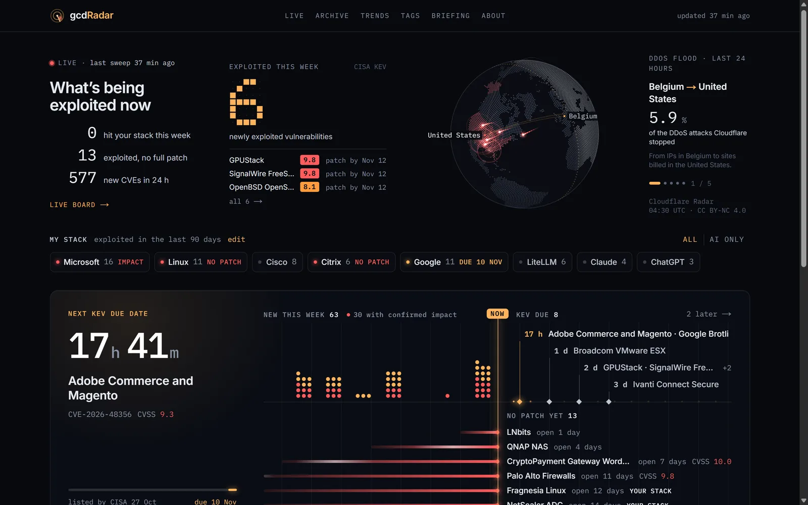
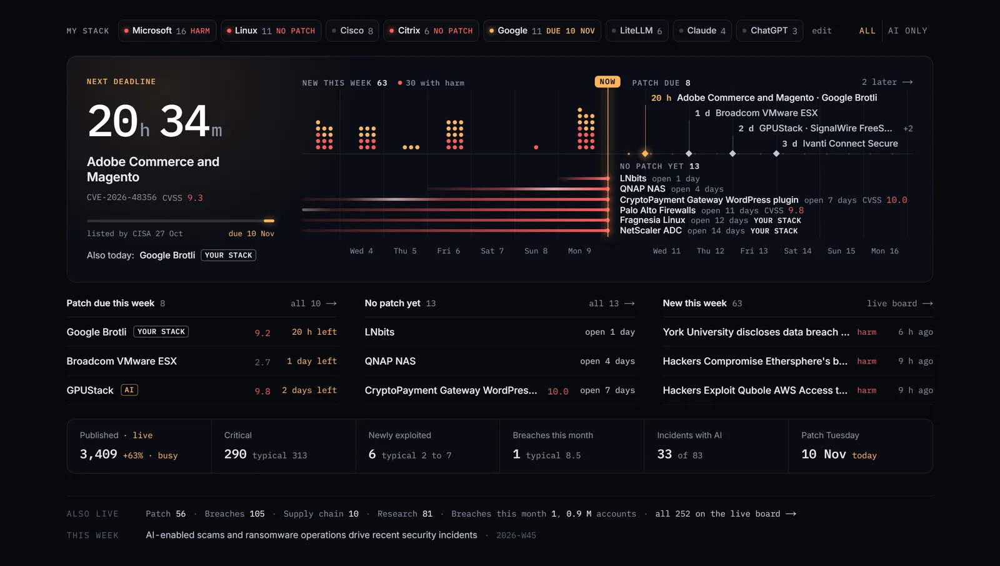
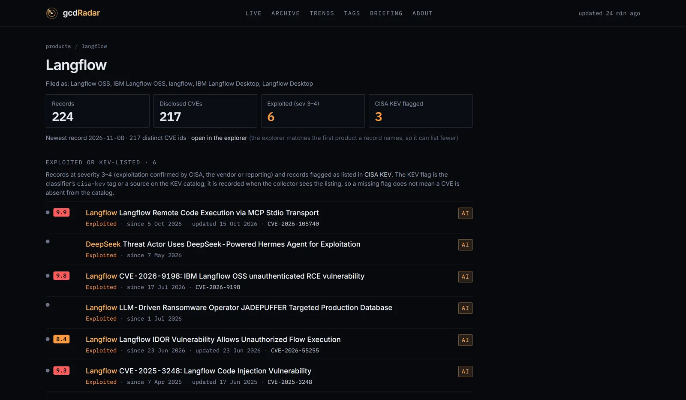
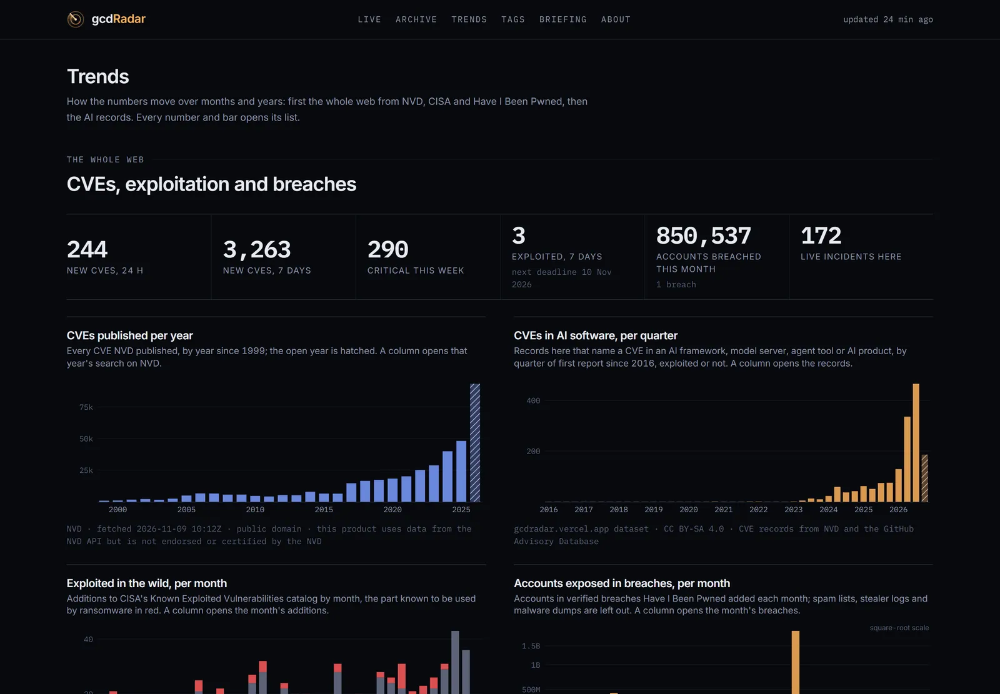
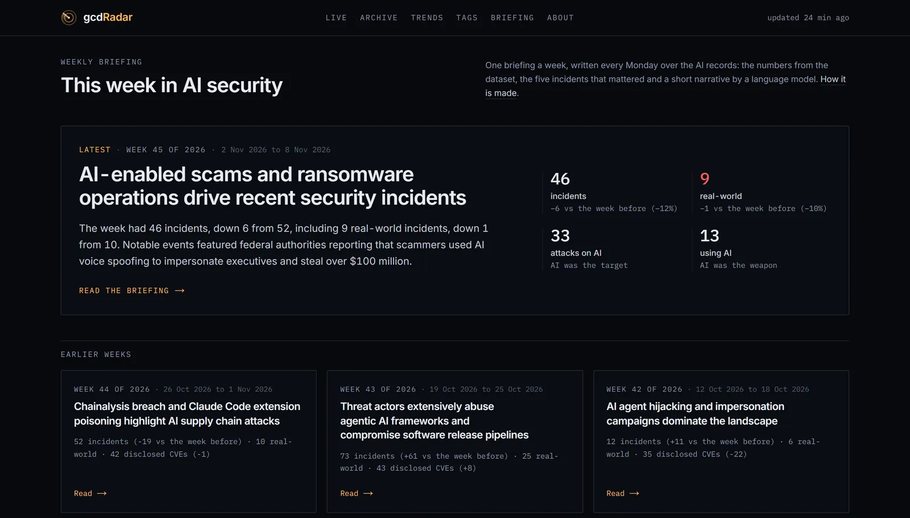

<div align="center">

# gcdRadar

**What's being exploited right now, whether there's a patch, and what to do about it, with an AI lens.**

[**gcdradar.vercel.app**](https://gcdradar.vercel.app) · free · no account · no cookies · no tracking

</div>

<a href="https://gcdradar.vercel.app"></a>

Security news is loud and spread across dozens of feeds. gcdRadar reads 45 of them, the advisories and the official databases (NVD, CISA KEV, GitHub Advisories, Have I Been Pwned) every 30 minutes and turns them into one calm page that answers three questions:

1. **Is anything I run being exploited?** Pick your products once and the page shows only what touches them.
2. **Is there a fix, and by when?** Every record carries a patch status and, when CISA has set one, the deadline.
3. **Is this week normal?** Every number sits beside a typical week, so a spike looks like a spike and a quiet week looks quiet.

Every record is counted once, however many outlets cover it, and links back to the reporting it came from.

## A day sheet, not a news feed

<a href="https://gcdradar.vercel.app"></a>

- **My stack.** One tile per product you care about, with its exploitation over the last 90 days and a red flag only while something is exploited and still open. Your picks stay in your browser; "share link" puts them in the URL so a teammate opens the same view.
- **Needs action.** One ledger: CISA patch deadlines due this week, exploited vulnerabilities with no full patch yet, and what's new this week with confirmed harm first. Plain scores, plain times ("1 day left", "open 3 days").
- **The week.** Published, critical and exploited CVEs, breaches and AI incidents, each against a typical week, plus the next Patch Tuesday.
- **Live board.** Everything open right now in four lanes: patch now, breaches and attacks, supply chain, research.

## Follow one product

<a href="https://gcdradar.vercel.app/products"></a>

Product watch pages gather everything that names one product or framework (Langflow, LiteLLM, Ollama, MCP servers and many more), with confirmed exploitation and CISA KEV listings at the top. Tags group records by technique, target and actor.

## The AI lens

Every record says whether AI was involved and how: **AI was the target** (a model, agent or AI product was exploited, abused or leaked) or **AI was the weapon** (attackers used AI as a real part of the attack). Disclosed CVEs in AI software are tracked as their own series and never inflate the incident count.

<table>
<tr>
<td width="50%"><a href="https://gcdradar.vercel.app/trends"></a></td>
<td width="50%"><a href="https://gcdradar.vercel.app/briefing"></a></td>
</tr>
<tr>
<td><b>Trends.</b> CVEs per year since 1999, exploitation per month, breached accounts, and the rise of CVEs in AI software. Every bar opens its list.</td>
<td><b>Weekly briefing.</b> Every Monday: the week's numbers straight from the data, the incidents that mattered, and a short narrative that is checked against those numbers before it is published.</td>
</tr>
</table>

## Why trust the numbers

- **Counted once.** One event covered by fifteen outlets is one record with fifteen sources. Duplicates are merged by CVE id, link and title.
- **Sourced.** Every record links to its reporting; the [source list](https://gcdradar.vercel.app/sources) names every feed and API it reads. Feeds and official APIs only, no article text stored: only titles, links, dates and our own two-sentence summaries.
- **Open method.** The [methodology](https://gcdradar.vercel.app/methodology) gives every counting rule and a dated changelog of every change to them.
- **Open data.** 2,300+ records back to 2016, published as JSON in [`/data`](data) under CC BY-SA 4.0.

## How it works

```
45 feeds + official APIs ──▶ collector (GitHub Actions, every 30 min) ──▶ /data/*.json ──▶ static Next.js site (Vercel)
                             fetch → pre-filter → dedupe → LLM classify → publish / review / reject → commit
```

- The collector (`/collector`, TypeScript) classifies candidates with free-tier LLMs (Gemini first, Groq as fallback). Anything it cannot classify waits in a pending file: nothing is dropped and nothing is published unclassified.
- Data commits land on `main` all day; the site rebuilds twice a day (06 and 18 UTC) and on every merge. The home page's live layer (the NVD count and the Cloudflare Radar globe) comes from a small Cloudflare Worker, so it stays current between builds.
- The site is static files with no server code, cookies, accounts or analytics. The [security model](docs/security.md) describes what runs where and what protects it.

**Tech:** Next.js, TypeScript, Zod, Tailwind, GitHub Actions, Vercel, Cloudflare Workers. Classification by Gemini and Groq free tiers.

## Development

```bash
npm install
npm run dev          # http://localhost:3000
npm test             # unit tests (dedupe, schema, stats, briefing)
npm run typecheck && npm run lint
npm run build        # static export to ./out
```

Collector commands, the GitHub Actions secrets, the deploy windows and what happens if a free tier disappears are in [docs/operations.md](docs/operations.md). Sources and audits: [docs/sources.md](docs/sources.md), [docs/audit-2026-10.md](docs/audit-2026-10.md).

## Part of the gcd family

[gcdatlas](https://gcdatlas.com) (the real universe, drawn in ASCII) · [gcdTracker](https://gcdtracker.vercel.app) (AI traffic and agent activity) · [gcdSignal](https://gcdsignal.vercel.app) (a local-first AI news reader)

## Licences

Code: [MIT](LICENSE). Data: [CC BY-SA 4.0](LICENSE-DATA.md), with upstream attributions listed there. If you reuse the counts, credit gcdRadar with a link and the date you accessed it.
